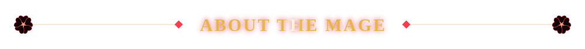
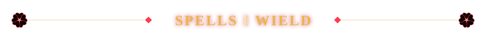
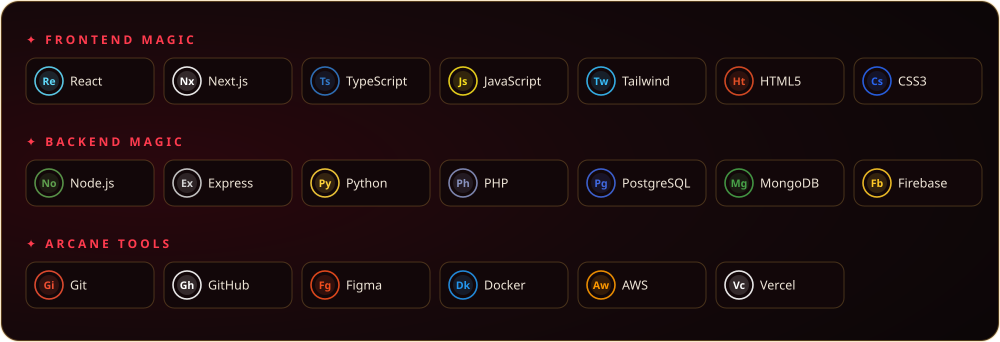
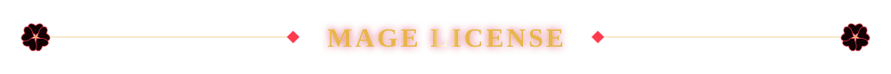
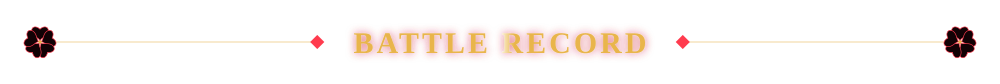

  

<h3 align="center">⚔️ Hey, I'm shahanarain — a developer forging digital products.</h3>

<i>"Talent is a spark. Practice is the flame."</i>

  

- 🔥 Building modern web experiences with **React**, **Next.js** and **TypeScript**
- 📖 Always studying new spells (frameworks) and sharpening old ones
- 🗡️ Every bug is just another trial on the path to mastery
- 💬 Ask me about web development, UI design and turning ideas into real products

  
  

  
  

  
  

  

<!--
  Edit me:
  - Intro & bullets: this file
  - Tech stack: SPELLS in scripts/build-static.mjs, then `node scripts/build-static.mjs`
  - Banner: scripts/banner.cjs → `node scripts/banner.cjs assets/banner.svg`
  - Mage License + snake update daily via .github/workflows/grimoire.yml
-->
